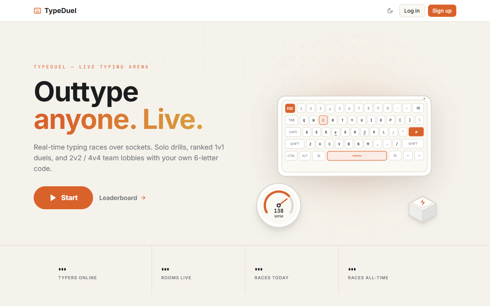

<div align="center">

# ⌨️ TypeDuel

**Real-time multiplayer typing races, solo speed drills, ranked 1v1 duels, and team lobbies.**

[](https://opensource.org/licenses/MIT)
[](https://www.typescriptlang.org/)
[](https://react.dev/)
[](https://vitejs.dev/)
[](https://socket.io/)
[](https://tailwindcss.com/)

<br />



</div>

<br />

## ⚡ Highlights

- **Solo Practice Mode**: Timed drills with live WPM, accuracy %, raw speed, and consistency telemetry across 15s, 30s, 60s, and 120s sessions.
- **Ranked 1v1 Duels**: Real-time matchmaking that pairs you with opponents of similar skill based on an Elo rating system.
- **Private Team Lobbies**: Create or join custom rooms with a 6-letter lobby code. Supports 1v1, 2v2, and 4v4 team races.
- **Server-Side Anti-Cheat**: Validates keystroke cadence, interval deltas, and session duration on the server to prevent paste scripts and macros.
- **Zero Input Lag**: Direct caret tracking and minimal DOM updates designed for high-speed typing accuracy.
- **Live Leaderboards**: Daily, weekly, and all-time rankings across Easy, Normal, and Hard word pools.
- **Theme Support**: Seamless Dark Mode and Light Mode with system preference detection.

---

## 🛠️ Tech Stack

### Frontend (`/client`)
- **React 18** with **TypeScript**
- **Vite** for fast hot module replacement and optimized production builds
- **Tailwind CSS** with CSS custom properties design tokens
- **Socket.io Client** for low-latency bidirectional game state syncing
- **Lucide Icons** & custom vector SVG graphics
- **Zustand** for lightweight global auth and theme state

### Backend (`/server`)
- **Node.js** with **Express** & **TypeScript**
- **Socket.io** server handling room matchmaking, race ticks, and live progress broadcasts
- **SQLite** (`better-sqlite3`) for persistent users, race results, and leaderboard stats
- **Argon2id** password hashing & JWT authentication via secure HTTP-only cookies
- **Zod** for schema validation and request sanitization

---

## 🚀 Getting Started

### Prerequisites
- [Node.js](https://nodejs.org/) (v18.0.0 or higher)
- [npm](https://www.npmjs.com/) (v9.0.0 or higher)

### Installation

1. **Clone the repository**
   ```bash
   git clone https://github.com/anujcodess1/TypeDuel.git
   cd TypeDuel
   ```

2. **Install dependencies**
   ```bash
   npm install
   ```

3. **Configure environment variables**
   ```bash
   cp .env.example .env
   ```
   *(The default `.env.example` settings work out-of-the-box for local development).*

4. **Start the development servers**
   ```bash
   npm run dev
   ```
   - Client runs on `http://localhost:5173`
   - Server runs on `http://localhost:3001`

---

## 📁 Repository Structure

```text
TypeDuel/
├── client/                     # Frontend SPA (React + Vite)
│   ├── src/
│   │   ├── components/         # Typing area, timers, navbar, footer, SVGs
│   │   ├── pages/              # Solo, Duel, Room, Leaderboard, Auth pages
│   │   ├── services/           # Socket.io and REST API client
│   │   ├── store/              # Auth, theme, and toast state
│   │   └── styles/             # Tailwind & theme variables
│   └── package.json
│
├── server/                     # Backend API & Socket Service
│   ├── src/
│   │   ├── db/                 # SQLite connection, migrations, and repositories
│   │   ├── middleware/         # Auth, validation, error handler, rate limiters
│   │   ├── routes/             # REST routes for auth, stats, leaderboard
│   │   ├── services/           # Anti-cheat, matchmaking, rooms, words generator
│   │   ├── sockets/            # Real-time WebSocket event handlers
│   │   └── index.ts            # Server entry point
│   └── package.json
│
├── assets/                     # Screenshots and graphics
├── .env.example                # Safe environment variable template
├── .gitignore                  # Airtight ignore rules for secrets and databases
└── package.json                # Monorepo workspace configuration
```

---

## 🔒 Security & Privacy

- Sensitive credentials, API keys, and local SQLite databases (`.env`, `typeduel.db`) are excluded from version control via `.gitignore`.
- Keystroke integrity is verified server-side with rate limiting and cadence anomaly detection.
- Authentication utilizes Argon2id password hashing and secure token rotation.

---

## 📄 License

This project is licensed under the [MIT License](LICENSE).
